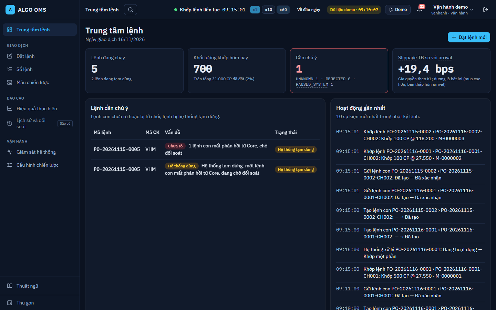

# OMS Algo

Hệ thống quản lý lệnh nâng cao (Advanced Order Management System) cho sàn HOSE, tổ chức theo dạng monorepo.
Khách hàng và dealer đặt lệnh thuật toán (Stop, Stop Limit, Take Profit, Trailing Stop, OCO, Bracket, Iceberg, TWAP,
VWAP, POV, HUNT). OMS tự chia thành lệnh con, gửi xuống Core, theo dõi khớp, xử lý lỗi và đối soát.

> **Trạng thái:** bản demo frontend **v0.1.0** ([CHANGELOG](CHANGELOG.md)): 8 màn hình, Chế độ Demo, kiểm thử Vitest và
> Playwright ([báo cáo chất lượng](docs/quality-report.md)). Chạy độc lập bằng dữ liệu giả lập (MSW và bộ giả lập thị
> trường trong trình duyệt), có ghi chú "Dữ liệu demo" trên header. Backend (FastAPI) và simulators chưa có code.



## Tính năng

- **Giới thiệu và đăng nhập** (`/`, `/login`): một màn hai cột. Bên trái giới thiệu sản phẩm, bên phải chọn tài khoản
  demo. Đã đăng nhập thì vào thẳng Trung tâm lệnh.
- **Khung ứng dụng** cho mọi trang sau đăng nhập. Thanh bên có menu theo vai trò, thu gọn được còn icon và nhớ lựa chọn
  sau khi tải lại trang. Mục Lịch sử và đối soát đang khóa, ghi "Sắp có".
  Thanh trên có phiên HOSE và giờ giả lập, nút tua x1/x10/x60, breadcrumb, nhãn "Dữ liệu demo · cập nhật", chuông
  thông báo và tài khoản. Màn ≤1280px thì thanh bên tự thu gọn; dưới 1600px thanh trên chỉ giữ tên màn hiện tại.
- **Trung tâm lệnh** (`/trung-tam`, trang mặc định):
  - 4 chỉ số: lệnh đang chạy (kèm số đang tạm dừng), khối lượng khớp hôm nay trên tổng đã đặt, số lệnh cần chú ý
    (chia theo UNKNOWN / REJECTED / PAUSED_SYSTEM), slippage trung bình so với giá arrival.
  - Bảng lệnh cần chú ý; bấm một dòng để mở chi tiết lệnh.
  - 10 hoạt động gần nhất.
  - Khách hàng chỉ thấy lệnh của tài khoản mình; dealer thấy các tài khoản mình quản lý; vận hành thấy tất cả.
- **Thông báo**: sinh từ nhật ký lệnh theo các loại trong spec (kích hoạt lệnh, kích hoạt điều kiện, lệnh con bị từ chối,
  hệ thống tạm dừng, hoàn tất, hủy, hết hạn).
  - Chuông có badge số chưa đọc.
  - Bấm một thông báo thì nó được đánh dấu đã đọc và mở lệnh tương ứng; có nút "Đánh dấu tất cả đã đọc".
- **Báo cáo hiệu quả thực hiện** (`/bao-cao/hieu-qua`):
  - So giá khớp bình quân của từng lệnh với giá arrival và VWAP toàn thị trường cùng khoảng thời gian; có tỷ lệ tham gia.
  - Lọc theo khoảng thời gian (Hôm nay / 5 phiên), trạng thái, chiến lược, chiều, mã; dealer và vận hành lọc thêm theo
    tài khoản.
  - 4 chỉ số, bảng sắp xếp được theo từng cột, biểu đồ bps theo chiến lược kèm một câu nhận xét.
  - Nút "Xuất Excel" tải file CSV mở được bằng Excel tiếng Việt.
  - Chi tiết lệnh có thẻ "Hiệu quả" dùng cùng công thức.
  - Công thức: [docs/frontend-spec.md](docs/frontend-spec.md), mục 12.
- **Sổ lệnh 3 mức** (Đợt 4): 3 mức mua, 3 mức bán theo đúng luật HOSE.
  - Có ở màn Đặt lệnh (bấm một mức để điền giá vào lệnh) và ở Chi tiết lệnh.
  - Ô đổi giá trị nháy màu; KL lệnh của bạn vừa lấy hiện số âm màu vàng.
  - Trong ATO, ATC hiện giá dự kiến khớp và ghi rõ là phiên khớp lệnh định kỳ.
- **HUNT quét từng mức** (Đợt 4): lệnh HUNT quét lần lượt từng mức giá, không vượt giá tối đa (mua) hoặc thấp hơn giá
  tối thiểu (bán).
  - Chi tiết lệnh hiện từng bước, ví dụ "Quét mức 27.650: lấy 6.400, còn thiếu 1.600", kèm trạng thái và giá bình quân.
  - Mức đang quét được viền nhấn trên sổ lệnh; nút "Xem lại" phát lại các bước.
- **Mẫu chiến lược** (Đợt 4, `/mau-chien-luoc`): 6 mẫu một chạm, gồm Mua âm thầm, Bán êm trong 2 giờ, Theo nhịp thị
  trường, Bám VWAP cả phiên, Mua nhanh khi có thanh khoản, Cắt lỗ tự động.
  - Bấm thẻ mẫu trên ticket hoặc "Dùng mẫu này" thì form được điền sẵn; bạn vẫn sửa được mọi ô và form vẫn kiểm tra như
    cũ.
  - Báo cáo hiệu quả ghi tên mẫu của lệnh.
- **Vì sao lệnh này…** (Đợt 5): đầu Chi tiết lệnh có thẻ giải thích bằng tiếng Việt vì sao lệnh đang dừng, bị từ chối,
  chưa rõ trạng thái, chờ kích hoạt, hết hạn hay đã xong.
  - Câu sinh theo quy tắc từ dữ liệu của lệnh, không gọi AI. Mọi số trong câu đều có trong dữ liệu; thiếu thì ghi
    "chưa đủ dữ liệu".
  - Nút đi kèm: "Sửa giá" (điền sẵn giá trần hoặc sàn hợp lệ), "Xem nhật ký"; vận hành có thêm "Mở lại", "Đối soát ngay".
  - Bấm một dòng lệnh con để xem giải thích riêng. Ở Sổ lệnh và Trung tâm lệnh, rê chuột vào badge trạng thái để xem câu
    rút gọn.
- **Thuật ngữ** (Đợt 5): chữ có gạch chân chấm (VWAP, arrival, bps, giá trần…) mở giải thích khi rê chuột hoặc bấm Tab.
  - Tooltip có công thức và ví dụ bằng số của lệnh đang xem; Esc đóng.
  - Trang `/thuat-ngu` (cuối thanh bên) để tra cứu, lọc không dấu.
- **Tìm nhanh** (Đợt 5): Ctrl+K (Cmd+K trên Mac) hoặc nút tìm trên thanh trên cùng.
  - Tìm lệnh, mã chứng khoán, màn hình, thao tác (Đặt lệnh mới, Dùng mẫu…, Chạy Demo) và thuật ngữ, gõ không dấu cũng
    được.
  - Kết quả theo quyền của vai trò; nhớ 5 mục mở gần nhất.
- **Hướng dẫn lần đầu** (Đợt 5): tour 5 bước khi mỗi vai trò đăng nhập lần đầu; xem lại ở menu tài khoản
  "Xem hướng dẫn". Không chạy khi đang Demo.
- **Chế độ Demo**: app tự chạy 6 kịch bản E2E (Iceberg, Stop → Iceberg, POV, HUNT, Core mất ACK, OMS sập).
  - Mỗi bước có chú thích, tô sáng phần tử liên quan và tự chấm điều kiện kiểm tra.
  - Chạy trên dữ liệu riêng; thoát thì dữ liệu của bạn trở về nguyên vẹn.
  - Cách bật ở mục [Chế độ Demo](#chế-độ-demo).
- **5 màn nghiệp vụ**: xem bảng [Màn hình](#màn-hình). Mọi màn dùng chung các trạng thái đang tải, trống (có câu hướng
  dẫn và nút hành động) và lỗi (có nút "Thử lại").
- **Truy cập bằng bàn phím** (Đợt 6): đặt lệnh trọn vẹn bằng Tab, Enter, Esc; mọi phần tử nhận focus có viền rõ; chữ đạt
  tương phản tối thiểu 4,5:1.

Bộ ảnh bản v0.1.0 (1440×900, mọi màn chính): [docs/screenshots/v0.1.0/](docs/screenshots/v0.1.0/), chụp lại bằng
`npm run screenshots`. Ảnh theo từng đợt: [docs/screenshots/dot1/](docs/screenshots/dot1/) (khung ứng dụng, Trung tâm lệnh),
[docs/screenshots/dot2/](docs/screenshots/dot2/) (báo cáo hiệu quả, thẻ Hiệu quả ở chi tiết lệnh),
[docs/screenshots/dot3/](docs/screenshots/dot3/) (Chế độ Demo, ảnh 1440px),
[docs/screenshots/dot4/](docs/screenshots/dot4/) (Đặt lệnh có dải mẫu và sổ lệnh 3 mức, Chi tiết lệnh HUNT có khung quét
từng mức, trang Mẫu chiến lược),
[docs/screenshots/dot5/](docs/screenshots/dot5/) (Chi tiết lệnh PAUSED_SYSTEM có thẻ giải thích, tooltip thuật ngữ,
hộp tìm nhanh Ctrl+K, một bước tour; ảnh 1440px).

## Cấu trúc thư mục

```text
OMS_Algo/
├── frontend/             # Giao diện web (Vite + React + TypeScript), chạy được với dữ liệu giả lập
│   ├── e2e/              # Test giao diện Playwright (*.spec.ts) và fixture chung
│   └── src/
│       ├── pages/        # Mỗi màn hình một thư mục
│       ├── mocks/        # API giả lập (MSW), bộ giả lập giá, engine sinh lệnh con / khớp / bơm lỗi
│       ├── services/     # Hàm gọi API: nối backend thật chỉ cần đổi ở đây
│       ├── config/       # Luật HOSE, loại lệnh, tham số hệ thống, màu trạng thái, từ điển thuật ngữ
│       ├── explain/      # Giải thích lệnh theo quy tắc (hàm thuần) và thẻ giải thích
│       ├── tour/         # Tour hướng dẫn lần đầu
│       ├── testing/      # Cờ chỉ dùng khi test e2e (seed, làm lỗi API); không có trong bản build
│       └── types/        # Kiểu dữ liệu theo ERD
├── backend/              # Dịch vụ OMS chính (Python, FastAPI): chưa có code
├── simulators/           # Giả lập hệ thống bên ngoài (Core, giá) để test: chưa có code
├── docs/
│   ├── frontend-spec.md  # Đặc tả frontend
│   ├── backend-gaps.md   # Những gì backend cần bổ sung so với ERD, và tồn đọng kỹ thuật
│   ├── quality-report.md # Số test, thời gian chạy, kích thước bundle, lỗi đã sửa ở Đợt 6
│   ├── demo-checklist.md # 10 việc trước buổi demo
│   ├── test-cases/       # Bộ test case E2E và bảng phủ test
│   ├── screenshots/      # Ảnh chụp giao diện theo từng đợt
│   └── adr/              # Architecture Decision Records
├── scripts/              # Script tiện ích: chưa có
└── .claude/              # Cấu hình Claude Code dùng chung
```

## Chạy frontend

Cần Node.js (đã chạy với Node 26) và npm.

```bash
cd frontend
npm ci
npm run dev
```

Mở địa chỉ Vite in ra (mặc định http://localhost:5173), chọn một tài khoản demo rồi bấm "Vào hệ thống". Không cần backend:
mặc định app chạy với API giả lập. Trạng thái giả lập (lệnh, giá, cấu hình) lưu trong localStorage của trình duyệt;
nút "Về đầu ngày" trên header đưa mọi thứ về dữ liệu mẫu ban đầu.

Lệnh khác trong `frontend/`:

| Lệnh | Việc |
|---|---|
| `npm run lint` | ESLint |
| `npm run build` | Kiểm tra kiểu (`tsc -b`) và build |
| `npm run test` | Vitest. Test lệch tài liệu bị bỏ qua mặc định; chạy `VITE_TC_DEVIATIONS=1 npm run test` để xem chúng |
| `npm run test:e2e` | Playwright, 2 khung 1440×900 và 1366×768 (tự bật `npm run dev` nếu chưa chạy) |
| `npm run test:e2e:ui` | Playwright ở chế độ giao diện, chạy và xem từng bước |
| `npm run test:all` | lint → Vitest → build → Playwright; dùng trước khi demo hoặc merge |
| `npm run screenshots` | Chụp lại bộ ảnh vào `docs/screenshots/v0.1.0/` |

Cấu hình qua biến môi trường: xem `frontend/.env.example` (`VITE_API_BASE_URL`, `VITE_USE_MOCK`, `VITE_DEMO_MODE`).

## Kiểm thử

- **Vitest** (`src/**/*.test.ts`): luật HOSE, engine giả lập, 6 kịch bản Demo chạy headless, định dạng, độ tương phản màu.
- **Playwright** (`frontend/e2e/`): chạy trên Chrome có sẵn trong máy (không có thì Edge); **không** tải trình duyệt
  riêng, nên không cần `npx playwright install`. Không có cả hai thì cấu hình dừng và báo rõ.
  - Đồng hồ cố định (thứ Hai 16/11/2026, 09:10) qua `page.clock`, `Math.random` có seed qua `?e2e=1&seed=…`: kết quả lặp lại
    giữa các lần chạy.
  - Selector theo vai trò, nhãn và `data-demo-id`, không dựa vào class CSS.
  - Lỗi console hoặc request lỗi ở bất kỳ test nào đều làm test đó trượt.
  - Báo cáo HTML ở `frontend/playwright-report/`, ảnh và trace khi lỗi ở `frontend/test-results/` (đều không commit).
- Số liệu lần chạy gần nhất: [docs/quality-report.md](docs/quality-report.md).

## Chế độ Demo

App tự chạy 6 kịch bản E2E trong [TC-E2E.md](docs/test-cases/TC-E2E.md), để trình bày mà không phải thao tác tay.

**Bật Demo:**
- Đăng nhập `vanhanh` (vai trò Vận hành), bấm **▶ Demo** trên thanh trên cùng, chọn một kịch bản.
- Muốn mọi vai trò đều thấy nút Demo (ví dụ trình bày bằng tài khoản khách hàng): thêm `VITE_DEMO_MODE=true` vào
  `frontend/.env.local` rồi chạy lại `npm run dev`.

**Khi đang chạy:**
- Thanh trên có nhãn vàng "ĐANG CHẠY DEMO · Scenario n" và nút "Thoát Demo".
- Khung điều khiển ở đáy màn hình:
  - bước hiện tại và chú thích;
  - Phát / Tạm dừng, Bước tiếp, Làm lại, tốc độ x1 / x2 / x4;
  - kéo được, thả gần góc thì bám góc.
- Bảng "Điều kiện kiểm tra" bên phải: ĐẠT / KHÔNG ĐẠT / CHỜ.
- Phím tắt (chỉ khi đang Demo): `Space` phát / tạm dừng, `→` bước tiếp, `Esc` thoát.
- Chạy xong có hộp kết quả: chạy lại, chọn kịch bản khác, xuất kết quả ra CSV.

**Dữ liệu:**
- Trước khi chạy, app lưu nguyên trạng thái (lệnh, giá, cấu hình, localStorage của app, thông báo).
- Kịch bản chạy trên sổ lệnh trống với random có seed cố định, nên lần nào cũng ra cùng kết quả.
- Thoát Demo thì mọi thứ trở về đúng như lúc trước khi bấm.

Kịch bản trình bày 10 phút: [docs/demo-script.md](docs/demo-script.md). Việc cần làm trước buổi demo:
[docs/demo-checklist.md](docs/demo-checklist.md).

## Tài khoản demo

Không cần mật khẩu. Trang đăng nhập hiện 3 thẻ cho `khachhang`, `dealer`, `vanhanh`. `vanhanh2` ở dòng nhỏ bên dưới, dùng
khi cần người duyệt thứ hai.

| Tài khoản | Vai trò | Được dùng |
|---|---|---|
| `khachhang` | Khách hàng | Trung tâm lệnh, Màn 1, 2, 3 với tài khoản của mình |
| `dealer` | Dealer | Trung tâm lệnh, Màn 1, 2, 3, xem lệnh của nhiều tài khoản |
| `vanhanh` | Vận hành | Trung tâm lệnh và cả 5 màn |
| `vanhanh2` | Vận hành | Trung tâm lệnh và cả 5 màn. Người thứ hai để demo maker-checker ở Màn 5: một người tạo yêu cầu, người kia duyệt |

## Màn hình

| # | Đường dẫn | Màn hình | Nội dung chính |
|---|---|---|---|
| 0 | `/trung-tam` | Trung tâm lệnh | KPI, lệnh cần chú ý, hoạt động gần nhất. Trang mặc định sau đăng nhập |
| 1 | `/dat-lenh` | Đặt lệnh nâng cao | Bảng giá VN30 thu gọn, sổ lệnh 3 mức, dải mẫu một chạm, ticket đặt 11 loại lệnh, kiểm tra luật HOSE ngay khi nhập |
| 2 | `/so-lenh` | Sổ lệnh nâng cao | Bảng lệnh cha, tiến độ, trạng thái, lọc; Sửa, Hủy, Tạm dừng, Tiếp tục |
| 3 | `/so-lenh/:id` | Chi tiết lệnh | Lệnh con, khớp, biểu đồ thực hiện so với kế hoạch, giá bình quân so với arrival, sổ lệnh 3 mức, khung HUNT quét từng mức, nhật ký |
| 4 | `/van-hanh` | Giám sát hệ thống | Cảnh báo, lệnh hệ thống tạm dừng, kill switch, nút bơm lỗi demo |
| 5 | `/cau-hinh` | Cấu hình chiến lược | Tham số hệ thống, đổi theo maker-checker, lịch sử thay đổi |
| 6 | `/bao-cao/hieu-qua` | Hiệu quả thực hiện | So giá BQ với arrival và VWAP, tỷ lệ tham gia, biểu đồ theo chiến lược, tên mẫu đã dùng, xuất CSV |
| 7 | `/mau-chien-luoc` | Mẫu chiến lược | Lưới thẻ mẫu, tham số mặc định, "Phù hợp khi…", "Dùng mẫu này" mở Đặt lệnh đã điền sẵn |

## Tài liệu

- [docs/frontend-spec.md](docs/frontend-spec.md): đặc tả frontend (màn hình, luật HOSE, mô hình dữ liệu, quy tắc nghiệp vụ).
- [docs/test-cases/](docs/test-cases/): [bộ test case E2E](docs/test-cases/TC-E2E.md) và
  [bảng phủ test](docs/test-cases/coverage.md), gồm danh sách chỗ engine giả lập còn lệch tài liệu.
- [docs/demo-script.md](docs/demo-script.md): kịch bản trình bày Chế độ Demo trong 10 phút.
- [docs/backend-gaps.md](docs/backend-gaps.md): bảng, trường, API backend cần thêm ngoài ERD; tồn đọng kỹ thuật.
- [docs/quality-report.md](docs/quality-report.md): kết quả kiểm thử, kích thước bundle, lỗi đã sửa và việc còn tồn của v0.1.0.
- [docs/demo-checklist.md](docs/demo-checklist.md): checklist 10 mục trước buổi demo.
- [CHANGELOG.md](CHANGELOG.md): thay đổi theo phiên bản, Đợt 1–6.
